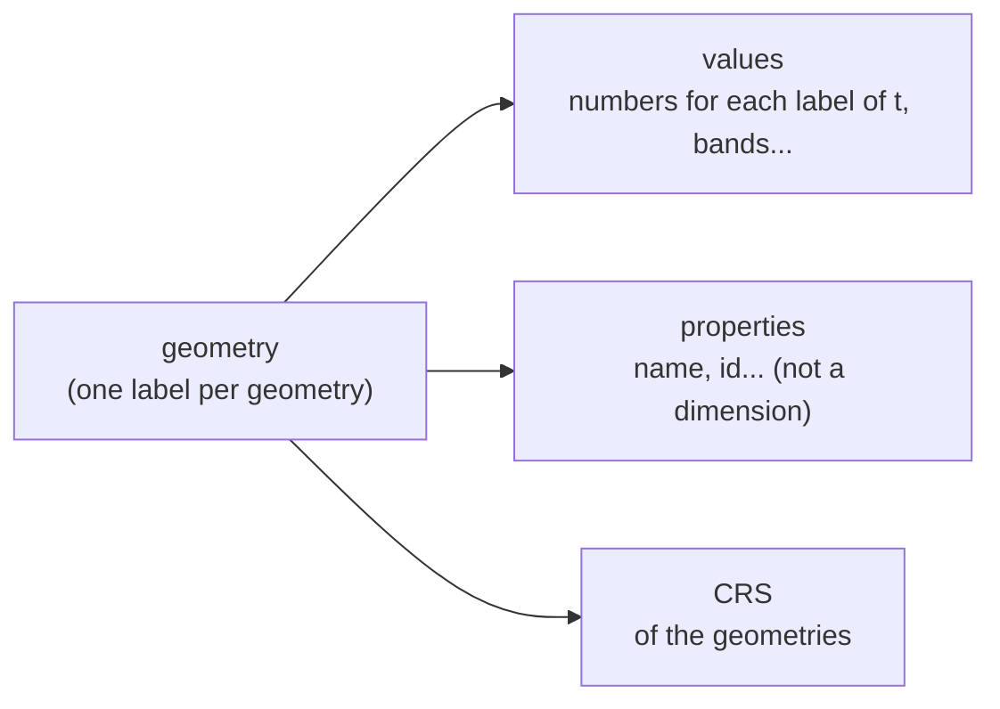

# Vector Data Cubes

A vector data cube holds values for geometries: for example the mean NDVI of
each field for each date. titiler-openeo makes vector data cubes from GeoJSON,
from vector files, from zonal statistics and from rasters, processes them, and
writes them in the usual GIS formats. The design is in
[ADR 0014](https://github.com/sentinel-hub/titiler-openeo/blob/main/docs/adr/0014-vector-cubes-and-formats.md).

Two notebooks show the features on Copernicus Data Space Ecosystem data:
[field monitoring](notebooks/vector_field_monitoring.ipynb) and
[rasters to polygons and back](notebooks/vector_raster_bridges.ipynb).

## The model

A vector data cube has a `geometry` dimension: one label for each geometry.
It can have more dimensions, for example `t` (dates) and `bands`. Each
geometry also has properties (attributes such as a name). The properties are
not a dimension of the cube.

Examples:

| Source | Dimensions |
|---|---|
| `load_geojson(data)` | `geometry` (no values) |
| `load_geojson(data, properties=["height", "width"])` | `geometry`, `properties` |
| `aggregate_spatial` on a one-band cube | `geometry`, `t` |
| `aggregate_spatial` on a cube with bands | `geometry`, `t`, `bands` |
| `raster_to_vector` | `geometry` (the pixel value of each polygon) |

openEO has no `vector-cube` type: the process specifications describe a
vector data cube as a `datacube` with a dimension of type `geometry`. In
Python, the class is `VectorCube`
(`titiler/openeo/processes/implementations/vector_model.py`).

## From raster to vector and back

| From | To | Process |
|---|---|---|
| GeoJSON | vector | `load_geojson` |
| A vector file (URL) | vector | `load_url` |
| Raster + geometries | vector | `aggregate_spatial` (zonal statistics) |
| Raster with one band | vector | `raster_to_vector`, alias `vectorize` (one polygon per zone of equal value) |
| Vector | raster | `vector_to_raster` (on the grid of a target raster) |
| Raster + geometries | raster | `filter_spatial`, `mask_polygon`, `apply_polygon` |

`raster_to_vector`, `vectorize` and `vector_to_raster` are not openEO core
processes. They have the same names and parameters as in the VITO back-end and
in the openEO Python client (`DataCube.raster_to_vector()`,
`VectorCube.vector_to_raster()`).

## Processes

### Vector processes

| Process | Notes |
|---|---|
| `vector_reproject` | EPSG code or WKT2. |
| `vector_buffer` | The distance is in metres. A CRS that is not in metres gives `UnitMismatch`, and the message names the UTM zone to use with `vector_reproject`. A negative distance shrinks polygons. Needs the `vector` extra. |
| `filter_vector` | Keeps a geometry if `relation(geometry, union of the other geometries)` is true, for example `within`. Needs the `vector` extra. |

### Bridges between raster and vector

| Process | Notes |
|---|---|
| `aggregate_spatial` | The geometries can be GeoJSON or a vector data cube. The result is a vector data cube in EPSG:4326. |
| `raster_to_vector` | 4-connected pixels of equal value become one polygon. The cube must have one band. Limited by `MAX_VECTOR_FEATURES` and `MAX_VECTORIZE_EDGES`. |
| `vector_to_raster` | The values of the cube (not the properties) on the grid of `target`. A pixel is covered by a polygon if its center is in it; points and lines cover the pixels on their path; the last geometry wins. The `t` labels become dates, one other dimension becomes the bands. |
| `filter_spatial` | Crops to the smallest window that holds the pixels of the geometries; the other pixels of the window have no data. |
| `apply_polygon` | Runs a process once for each polygon, on a sub-cube cropped to the polygon, with `mask_value` outside it. Pixels outside all polygons get `mask_value`. Overlapping polygons give `GeometriesOverlap`. |
| `mask_polygon` | A vector data cube is accepted as the mask. |

### Generic processes on a vector data cube

These processes work on the dimensions of a vector data cube other than
`geometry`.

| Process | Notes |
|---|---|
| `reduce_dimension` | The reducer is called once, with the reduced dimension on axis 0. The `geometry` dimension cannot be reduced. |
| `apply` | The process is called once, with all the values. |
| `filter_temporal`, `filter_labels`, `filter_bands` | No match gives a dimension without labels (openEO specification). `filter_bands` on a cube without bands gives `DimensionMissing`. |
| `rename_labels` | Any dimension except `geometry`. |
| `filter_bbox` | Keeps the geometries that are fully within the bounding box. |
| `merge_cubes` | Two vector data cubes: equal geometries (OGC equality) are joined, the others are appended. A cube with fewer dimensions is repeated along the others. Overlapping cells need `overlap_resolver`. A vector and a raster data cube cannot be merged. Needs the `vector` extra. |
| `save_result` | See the formats below. |

`add_dimension`, `drop_dimension`, `dimension_labels`, `rename_dimension`,
`apply_dimension`, `aggregate_temporal` and `aggregate_temporal_period` do not
support vector data cubes yet (`FeatureUnsupported`, HTTP 501).

A raster-only process (for example `ndvi` or `resample_spatial`) gives a clear
error for a vector data cube, with a hint to use `vector_to_raster`.

## Formats

### Output (`save_result`)

| Format | Aliases | Media type | Needs the `vector` extra | Notes |
|---|---|---|---|---|
| GeoJSON | | `application/geo+json` | no | Always EPSG:4326 (RFC 7946). |
| JSON | | `application/json` | no | The values by date (and band). |
| CSV | | `text/csv` | no | No geometry. One row per geometry and date. `feature_index` is the position of the geometry in the cube. |
| GeoParquet | `parquet` | `application/vnd.apache.parquet` | yes | Keeps the CRS of the cube. Option `compression`. |
| GPKG | `geopackage` | `application/geopackage+sqlite3` | yes | Keeps the CRS. Option `layer_name`. |
| FlatGeobuf | `fgb` | `application/vnd.flatgeobuf` | yes | Keeps the CRS. The features are ordered by the spatial index. |
| ESRI Shapefile | `shapefile`, `shp` | `application/zip` | yes | A ZIP file. Field names have 10 characters at most; dates are text. Option `encoding`. |

The GIS formats have one row for each geometry and each date (one row for
each geometry if there is no `t` dimension), with the properties, a `t`
column, and one column for each label of the other dimensions. A column that
has the name of a property gets a suffix, for example `value_1`. The
`/result` response gives a file name (`Content-Disposition`).

### Input (`load_url`)

| Format | Aliases | Needs the `vector` extra | Notes |
|---|---|---|---|
| GeoJSON | | no | Downloaded in full: `MAX_VECTOR_DOWNLOAD_BYTES`. |
| GeoParquet | `parquet` | yes | Downloaded in full: `MAX_VECTOR_DOWNLOAD_BYTES`. |
| GPKG | `geopackage` | yes | Read with HTTP range requests. Option `layer_name`. |
| FlatGeobuf | `fgb` | yes | Read with HTTP range requests. |
| ESRI Shapefile | `shapefile`, `shp` | yes | A `.zip` or a `.shp` URL. |
| GTiff | `COG`, `GeoTIFF` | no | Raster: the existing COG path. |

`GET /file_formats` lists the formats that the deployment supports. Without
the `vector` extra, the formats that need it are not listed. The Docker image
installs the extra.

`load_url` reads public `http` and `https` URLs only. It cannot send
credentials, so it cannot read files that need a login, for example the
Copernicus Data Space Ecosystem vector assets.

## Limits

| Setting | Default | Limits |
|---|---|---|
| `TITILER_OPENEO_PROCESSING_MAX_VECTOR_FEATURES` | 100000 | The number of geometries in a vector data cube (`raster_to_vector`, `load_geojson`, `load_url`, `merge_cubes`). |
| `TITILER_OPENEO_PROCESSING_MAX_VECTORIZE_EDGES` | 5000000 | The pixel edges between zones in `raster_to_vector`, checked before GDAL starts. |
| `TITILER_OPENEO_PROCESSING_MAX_VECTOR_DOWNLOAD_BYTES` | 268435456 | The size of a GeoJSON or GeoParquet file that `load_url` downloads. |
| `TITILER_OPENEO_PROCESSING_MAX_PIXELS` | 100000000 | Also the result of `vector_to_raster` (width × height × dates × bands). |

See the [admin guide](admin-guide.md) for the other settings.

## Errors

| Code | HTTP | Cause |
|---|---|---|
| `OutputLimitExceeded` | 400 | Above one of the limits. |
| `UnitMismatch` | 400 | `vector_buffer` on a CRS that is not in metres. |
| `IncompatibleGeometryTypes` | 400 | `merge_cubes` of points with polygons (or lines). A type merges with its multi type. |
| `OverlapResolverMissing` | 400 | `merge_cubes` with overlapping cells and no `overlap_resolver`. |
| `GeometriesOverlap` | 400 | `apply_polygon` with a pixel in two polygons. |
| `DimensionMissing` | 400 | `filter_bands` on a vector data cube without a `bands` dimension. |
| `DimensionNotAvailable` | 400 | A dimension name that the cube does not have. |
| `ProcessParameterInvalid` | 400 | For example a vector data cube in a raster-only process. |
| `FeatureUnsupported` | 501 | A process that openEO allows on vector data cubes, but that this back-end does not support yet. |

## Known limits

- In a `bands` reducer, `array_element` works with `index`, not with `label`
  (raster and vector data cubes). See
  [#511](https://github.com/sentinel-hub/titiler-openeo/issues/511).
- On raster data cubes, a filter with no match gives `NoDataAvailable` in some
  processes and an empty result in others (#511).
- `merge_cubes` compares geometries exactly. A geometry that was reprojected
  and back is not equal to the original.
- `apply_polygon` does not support a text `mask_value`.
- `apply_kernel` replaces no-data with `replace_invalid` (0 by default), as
  the openEO specification says. Inside `apply_polygon`, the pixels outside the
  polygon are no-data. The
  [rasters to polygons notebook](notebooks/vector_raster_bridges.ipynb) shows
  a mean that uses the pixels of the polygon only.
